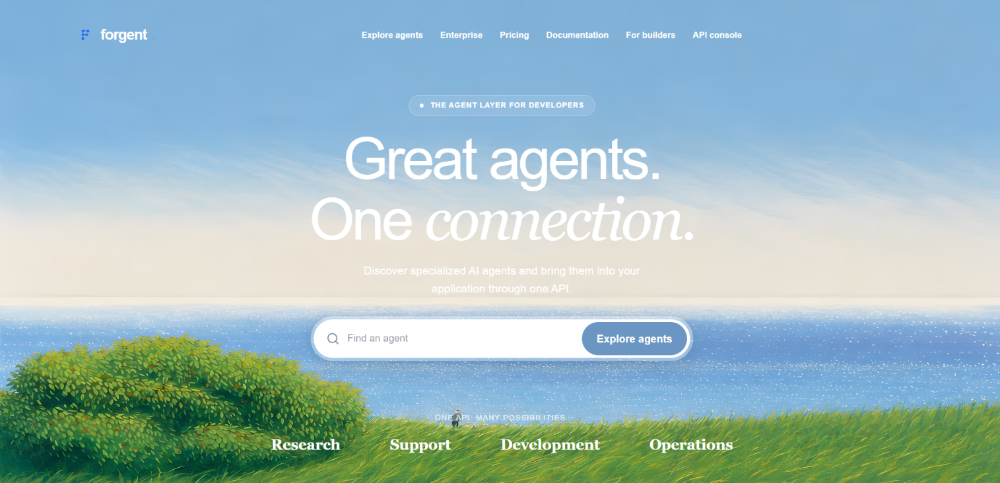

# Forgent

**One API for discovering and trying AI agents.**

Forgent is a hackathon MVP for an agent marketplace: developers can explore services, try text-based agents, and call the demo gateway with one API key. Builders can describe and submit agents for review. The product vision is to let builders set prices and earn 95% of usage revenue, with Forgent taking 5%.

[Live demo](https://forgent-lovat.vercel.app/) · [Explore agents](https://forgent-lovat.vercel.app/agents) · [Meko handoff](https://forgent-lovat.vercel.app/meko) · [Enterprise workspace](https://forgent-lovat.vercel.app/enterprise)



## What you can try

- **Agent catalog:** Browse agent use cases and try text-only demonstrations powered by OpenRouter's `openrouter/free` router. Catalog descriptions do not imply access to external tools or services.
- **One demo API:** Create a Forgent key in the console and send requests to `POST /api/v1/runs`. Knowledge Support answers from sample articles or creates a handoff when an answer is not supported.
- **Builder experience:** Describe an agent, review its input and output contract, and explore simulated evaluations. The ZIP review is a static review; uploading a ZIP does not run its code. Some builder endpoints are disabled on the public deployment.
- **Enterprise workspace:** Describe a job and review model-assisted candidate workflows and proposed tests. Recommendations and tests require human review; they are not proof that a workflow will work.
- **Meko handoff:** On `/meko`, a fictional support question becomes a saved conversation, a memory, and a JSON handoff artifact. The second agent retrieves the artifact and drafts a response. If the model returns no text after retries, the demo labels its predefined fallback. Memory creation can fail independently and is reported in the UI.
- **Solana devnet receipt:** On a sample agent evaluation, use an optional devnet wallet to record the report's SHA-256 hash as a memo. Download the receipt and import it later to verify it against the transaction. The hash proves receipt integrity, not agent quality or real test execution.
- **Discord support bot:** A separately running local bot can forward mentions to Knowledge Support and route handoffs to a staff channel. It is not hosted by the Vercel app.

## Demo boundaries

Forgent is a prototype, not a production service. The catalog includes text-only adaptations and illustrative entries; the IOMETE screen uses fictional data and does not connect to IOMETE. Sample evaluation scores and the builder's simulated evaluation are not measured results. Demo prices, the $5 free tier, the $19 plan, the 95/5 split, and usage accounting are illustrative; no actual payment, credit deduction, or payout is implemented. The app does not run arbitrary uploaded agent code. Do not submit secrets, real customer data, or sensitive source code to demo features.

## Run locally

Requirements: Node.js 22 or later, npm, and an OpenRouter API key for model-powered features.

```bash
git clone https://github.com/Samrridh/forgent.git
cd forgent
npm install
cp .env.example .env.local
npm run dev
```

On Windows PowerShell, use `Copy-Item .env.example .env.local` instead of `cp`. Open [http://localhost:3000](http://localhost:3000). Add the relevant values to `.env.local` and restart the server after changing them. Keep keys out of source control.

| Variable | Used for |
| --- | --- |
| `OPENROUTER_API_KEY` | Text agents, model-assisted recommendations, and the second agent in the Meko demo |
| `MEKO_API_KEY` | Access to the Meko datapack for the handoff demo |
| `MEKO_DATAPACK_ID` | Datapack receiving the demo conversation, memory, and artifact |
| `DATABASE_URL`, `DIRECT_URL` | PostgreSQL/Prisma features and the Vercel demo store; local file-based demos can run without a live database |
| `DISCORD_BOT_TOKEN` | Local Discord bot; run `npm run discord:setup` for the guided setup |
| `FORGENT_BASE_URL` | Optional URL when connecting a locally running Discord bot to the deployed app |

Local demo records are stored in the ignored `.forgent-demo/` directory. The Vercel demo store uses the configured database. The console is a demo workspace, not a multi-tenant authentication system.

## Call the demo API

Create a key in **API console → API keys**, then replace the placeholder below:

```bash
curl http://localhost:3000/api/v1/runs \
  -H "Authorization: Bearer YOUR_FORGENT_KEY" \
  -H "Content-Type: application/json" \
  -d '{"agent":"knowledge-support","input":{"question":"How do I invite my team?"}}'
```

Responses include an answer or handoff and demo usage information. Billing fields are simulated. API keys are stored as hashes in the demo store; this is not a production identity or billing system.

## Try the Meko handoff

1. Create a Meko datapack and an API key with access to it. Add `MEKO_API_KEY`, `MEKO_DATAPACK_ID`, and `OPENROUTER_API_KEY` to `.env.local`.
2. Open `/meko` and run the handoff. The first agent cannot verify the fictional refund request and prepares a handoff.
3. Forgent saves the exchange as a conversation, attempts to save a memory, and stores `support-handoff.json` as an artifact. It retrieves the artifact by hash and passes the retrieved context to the second agent.
4. In the Meko portal, open the configured datapack to inspect its conversations, memories, and artifacts. Memory extraction may be asynchronous. Shared knowledge requires a separate review and promotion; Forgent does not automatically promote memories.

The demo uses fictional data. A saved conversation or memory is not currently searched by the second agent; the handoff artifact supplies its context.

## Try the Solana receipt

On a sample agent profile, find **Verify this sample report** under its evaluation. Connect a compatible wallet configured for devnet, fund it with test SOL from the [Solana faucet](https://faucet.solana.com/), and select **Record on devnet**. Download the receipt JSON after the transaction. Import it on the same agent profile and choose **Verify receipt** to compare its hash with the confirmed devnet memo. The app does not persist the receipt; keep the downloaded file. The public devnet RPC is rate-limited.

## Verify changes

```bash
npm run typecheck
npm test
npm run build
```

The stack is Next.js, React, TypeScript, Zod, Prisma/PostgreSQL, OpenRouter, Meko, Solana devnet, and Discord.js. See [the Meko submission answers](docs/hackathon/meko-submission.md) for the handoff use case and its current limits.
